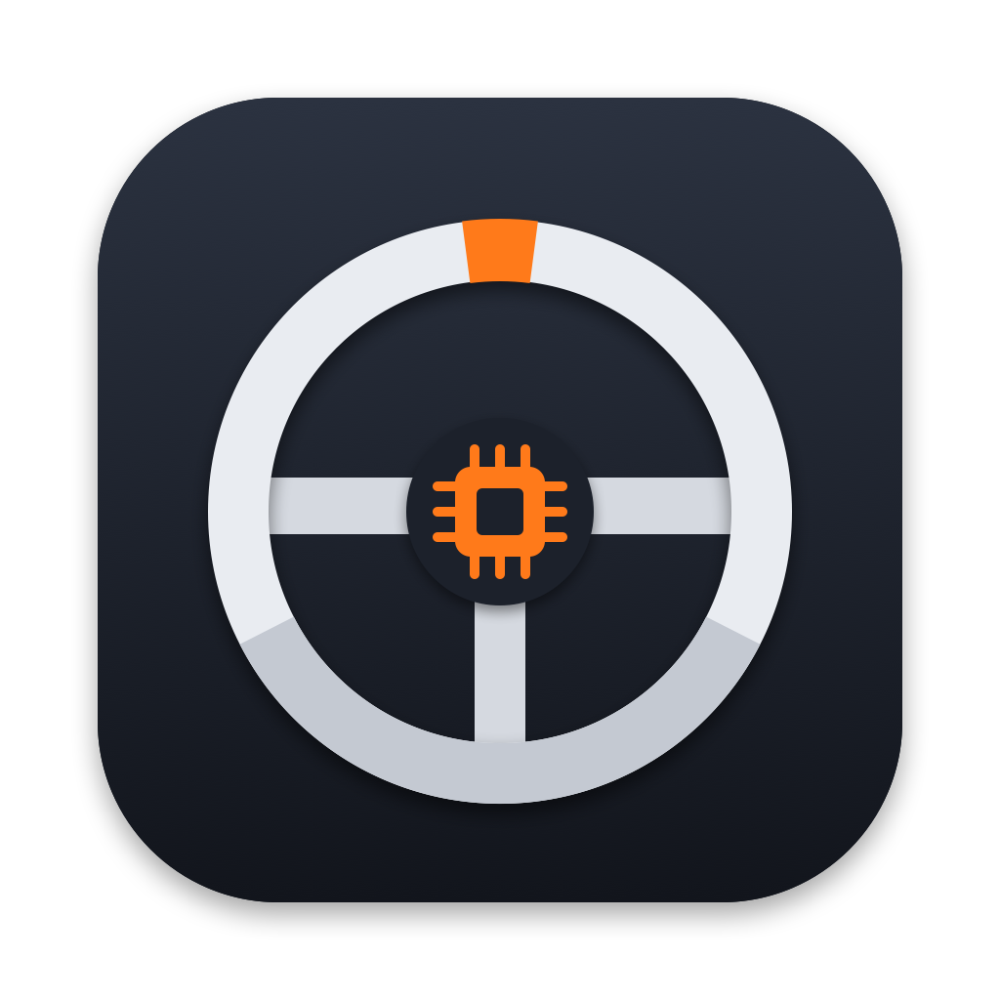

# T150 Firmware Updater for macOS

[](https://github.com/sebastianspicker/t150-macos-updater/actions/workflows/ci.yml)
[](LICENSE)


A native Mac app that updates the firmware of a Thrustmaster T150 racing wheel
over USB. You download the official Thrustmaster installer yourself. The app
reads the firmware out of it without running it, so you don't need Windows, Wine,
a virtual machine or Homebrew.

It can also install a modified V35 build that fixes the whole-game stutter in
Assetto Corsa Competizione on the PS5 (see [below](#the-acc-ps5-stutter)).

> [!WARNING]
> This is an independent, experimental project. It is not made, endorsed or
> supported by Thrustmaster. Updating firmware can leave a wheel unusable, and
> using unofficial software or modified firmware may void your warranty. You use
> it at your own risk. See the [disclaimer](#disclaimer).

## What it supports

- **Wheel:** Thrustmaster T150 with the V5 bootloader
- **Installer:** `2026_TTRS_2.exe` from Thrustmaster's T150 support page, which
  contains firmware V35
- **Mac:** Apple Silicon, macOS 14 or later (tested on macOS 27)

Anything else is refused: other installers, firmware versions, bootloaders and
wheel models. A future Thrustmaster release needs a new version of this app.
Renaming a newer installer won't get it accepted.

## How to use it

1. Get the app. There is no published download yet, so
   [build it from source](#build-from-source). The build is ad-hoc signed and not
   notarized. If you copy it to another Mac, Gatekeeper blocks it until you allow
   it in System Settings.
2. Download `2026_TTRS_2.exe` from the **Drivers** section of the
   [official T150 support page](https://support.thrustmaster.com/en/product/t150ffb-en/).
   Don't run it.
3. In the app, choose the installer and follow the steps: connect the wheel, put
   it into recovery mode, save two backups, review, update.
4. Keep the Mac on AC power, the wheel powered, and the USB cable connected until
   the app reports success. Keep hands and objects clear of the wheel: it
   calibrates after the restart.

Read the [user guide](docs/USER_GUIDE.md) before your first update. It also
covers recovery if something goes wrong.

## Firmware builds

Besides the official V35, the app offers six modified builds, made on your Mac
from the official image:

| Build in the app | Purpose |
| --- | --- |
| Official V35 | Thrustmaster's firmware, unchanged |
| **PS5 stutter fix** | **Fixes the ACC PS5 stutter.** Experimental. This is the build to use. |
| V35 + fixes | Fixes six firmware defects, such as a settings log overflow that eventually locks up the wheel and missing bounds checks on USB commands |
| Other experimental builds (4) | Earlier and alternative attempts at the stutter, kept for completeness. Collapsed in the app. |

Each build is checked against a pinned SHA-256 before anything is written. None
of them touches the bootloader, so you can always switch back to the official
firmware. [FIRMWARE_BUILDS.md](docs/FIRMWARE_BUILDS.md) lists what each build
changes and why.

## The ACC PS5 stutter

With a T150, the native PS5 version of Assetto Corsa Competizione stutters. It
gets worse with stronger force feedback and with wheel movement. The PS4 version
of the game on the same console is fine, and the official firmware doesn't help.

**The "PS5 stutter fix" build fixed it on a tester's T150.** Its full name is
"V35 + sibling mimic + T300 features + recorder".
They drove several ACC races on the PS5 without stutter, with the wheel fully
working. That is one owner's result, not a controlled measurement, and other games
and hardware revisions are untested.

Why it works, in short:

- The T300 RS and T248 are Thrustmaster's other PlayStation wheels. All three
  look the same to the console and send the same input stream, so the stream is
  not the problem. An earlier build that changed it didn't help.
- The T150 differs when the console asks it something. It sends 15-byte vendor
  replies where the others send 64 bytes, reports different capability bytes,
  and rejects feature report 0x49, which a T300 answers.
- The working build gives the T300's answers, in PlayStation mode only. The
  input stream stays the official one, and the force-feedback fixes are the same
  as in the build that didn't help. So the PS5 version of ACC most likely asks
  one of these questions while it runs and trips over the T150's original
  answer. ACC's console patch 1.9.1 (2023) had already fixed a "T150 causes the
  title to freeze intermittently" bug, so the game does have T150-specific code
  that can block.

Whether the 64-byte replies or the feature reports are the decisive part is
still open. The full reasoning is in
[FIRMWARE_BUILDS.md](docs/FIRMWARE_BUILDS.md#the-acc-ps5-stutter).

## Safety measures

- The installer is identified by the SHA-256 of the whole file before it is
  parsed. Only the firmware is extracted, and it must match the app's catalog.
- The native engine checks the firmware and the bootloader again on its own.
- Before writing, it reads the complete flash twice and saves both backups in a
  private session folder. It reads once more just before writing to make sure
  nothing changed.
- It never writes the first 8 KiB (the bootloader) and writes only the 4 KiB
  application sectors that differ.
- It verifies the complete flash before it restarts the wheel, then checks that
  the wheel reports the new version.
- Locks stop two operations from running at once. A failed write is never
  retried on its own.

Writing flash is not atomic. If USB or power drops during the write, the wheel
can be left with partly written firmware. The bootloader survives in that case,
so Thrustmaster's own recovery procedure should still work, but that has not been
tested.

## What has been tested

- **Official V35:** one T150 updated from V5 to V35 with the native engine. The
  full readback matched, the bootloader was unchanged, and the wheel calibrated
  normally.
- **PS5 stutter fix:** a second T150 updated with the packaged app to the
  "sibling mimic + T300 features" build. The app verified the image and the
  restart, and the stutter was gone in ACC on the PS5.
- **Offline:** the engine's built-in self-test and the maintainer's offline test
  suite (73 simulated update workflows) pass for the current version.

Not tested: other starting versions, downgrades, power loss during an update,
Intel Macs, and games or force feedback on macOS. Details are in the
[validation record](docs/VALIDATION.md).

## Build from source

You need Apple's command line developer tools with Swift 6 or newer, CMake 3.21
or newer (`brew install cmake` works), and an internet connection for the first
build, which downloads a pinned copy of Unshield.

```sh
git clone https://github.com/sebastianspicker/t150-macos-updater.git
cd t150-macos-updater
./script/package_app.sh
./script/build_and_run.sh --verify
```

The app ends up in `dist/T150 Firmware Updater.app`, with a zip next to it. The
last command opens the app and checks that macOS registered it. It does not touch
the wheel.

More in [DEVELOPMENT.md](docs/DEVELOPMENT.md). Changes per version are in the
[changelog](CHANGELOG.md).

## Contributing

Reports from real wheels help most: open a
[PS5 test report](https://github.com/sebastianspicker/t150-macos-updater/issues/new?template=ps5_report.yml)
whether the fix worked for you or not. For bugs, use the bug report template and
attach the logs, never the `.bin` backups. Code and doc changes are welcome; see
[CONTRIBUTING.md](CONTRIBUTING.md). Security problems go through
[SECURITY.md](SECURITY.md).

## Thanks

Many thanks to [Philipp](https://www.knick-in-der-optik.de/) for testing the
firmware builds on a real T150 and PS5. Philipp's races in ACC are what showed
that the PS5 stutter fix works.

## Disclaimer

This software is provided "as is", without warranty of any kind, as stated in
the [license](LICENSE). The authors are not liable for any damage, data loss,
bricked hardware, voided warranty, or other harm that results from using it,
including from installing official or modified firmware.

Updating firmware is risky. Modified firmware is not tested or approved by
Thrustmaster. Only use this app if you accept that your wheel may stop working
and that you may have to recover it yourself.

This project is not affiliated with Thrustmaster, Guillemot Corporation, Sony
Interactive Entertainment, Kunos Simulazioni or 505 Games. Thrustmaster, T150,
T300 RS, T248, PlayStation, PS4, PS5, DualShock and Assetto Corsa Competizione
are trademarks of their respective owners. They are used only to name the
products this software works with.

## License

The source code of this project is licensed under the [MIT License](LICENSE).

The MIT License covers only this project's own work. It does not cover
Thrustmaster's firmware, installer or driver, none of which are included here.
The patch tables in `Native/policy.inc` contain short fragments of the original
V35 firmware bytes, which the engine compares before it changes anything. Those
fragments remain Thrustmaster's property and are included only so the app can
check that it is patching the right firmware.

The bundled Unshield and its MD5 code have their own licenses; see
[THIRD_PARTY.md](docs/THIRD_PARTY.md).
