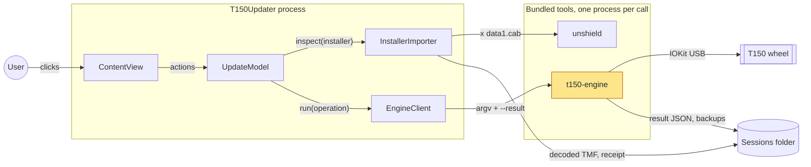
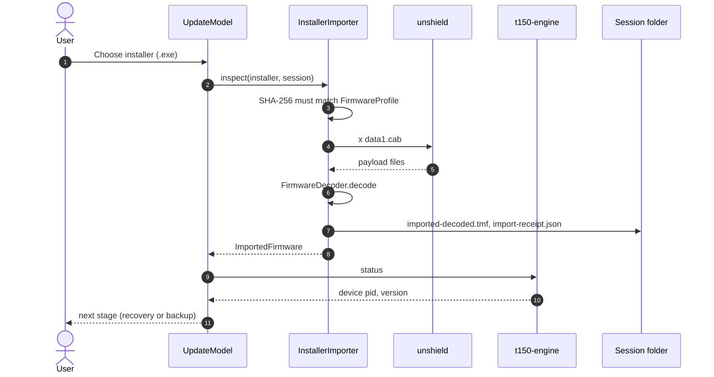
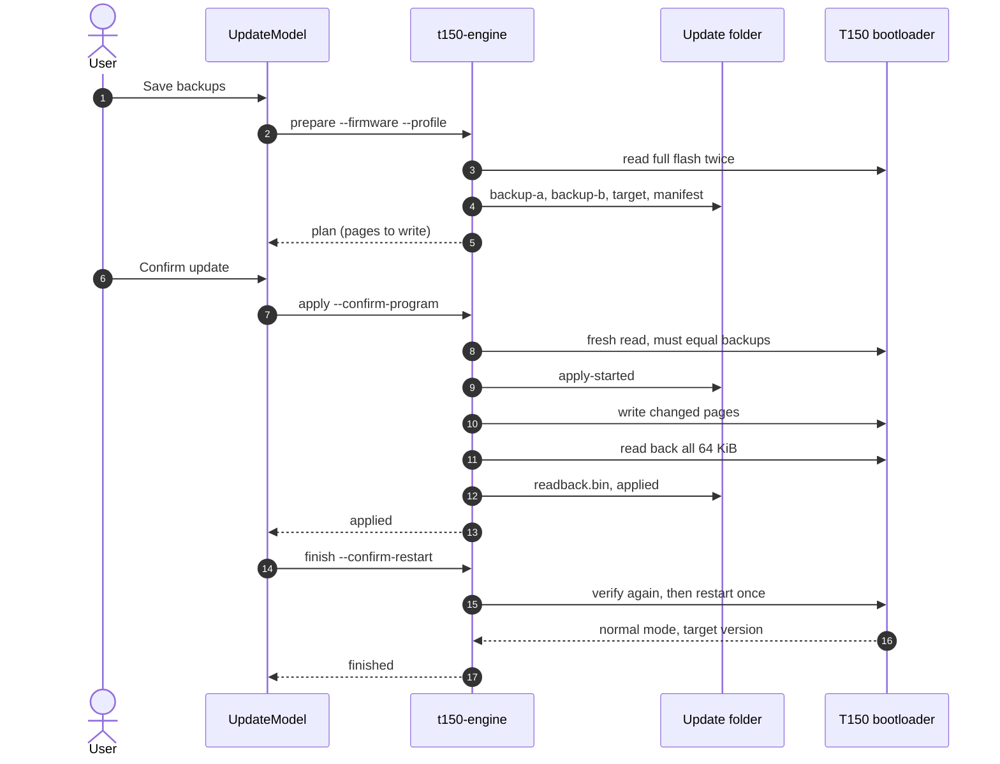
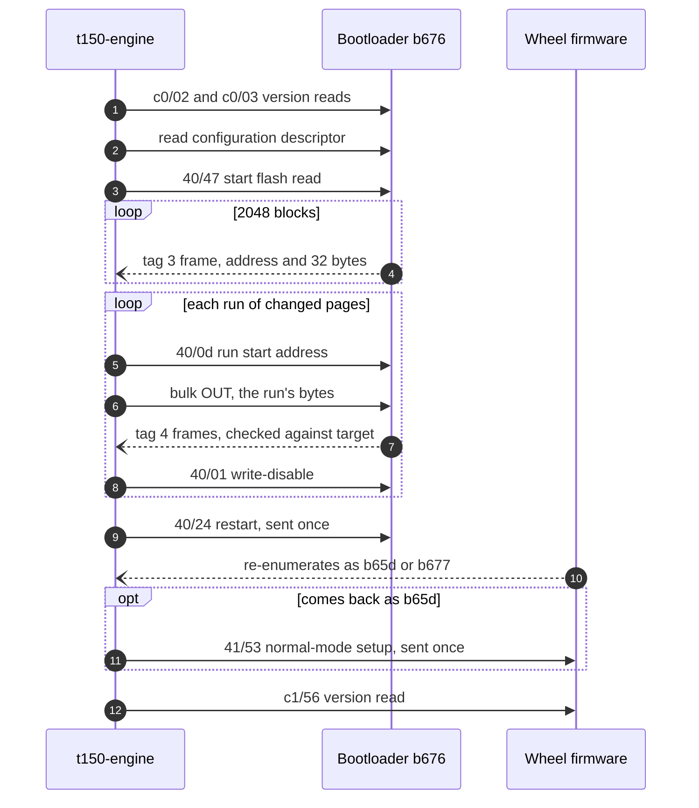
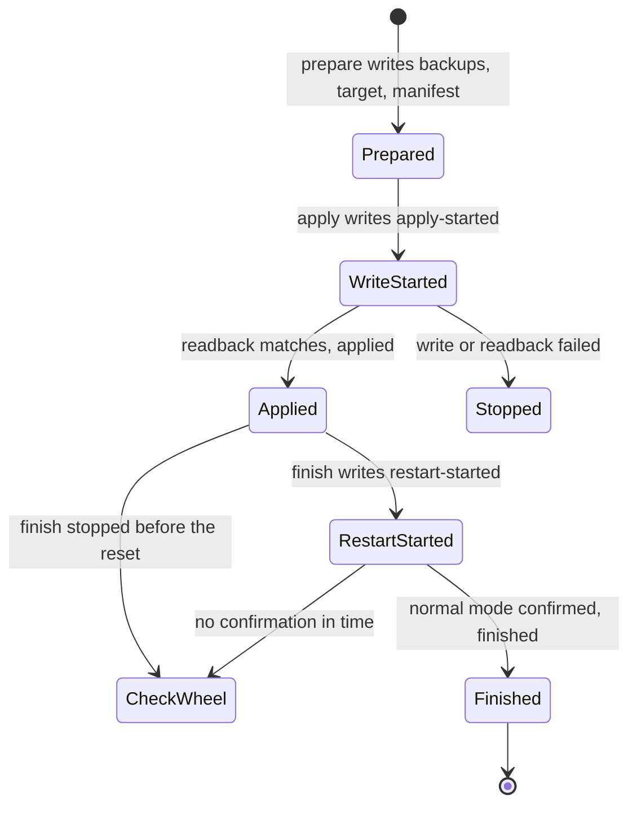
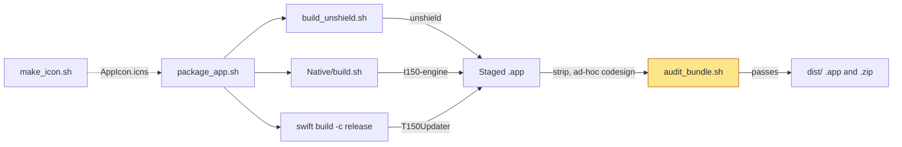

# Architecture

This page explains how the updater works inside: what runs where, what happens
when you import an installer and update a wheel, what goes over USB, where files
are kept, and how the app is built. For using the app, read the
[user guide](USER_GUIDE.md). For build commands and the target profile rules,
read [DEVELOPMENT.md](DEVELOPMENT.md).

## In one paragraph

The app is a SwiftUI program (`T150Updater`) with a small library (`T150Core`)
that reads the official Thrustmaster installer as plain data and decodes the
firmware from it. It never talks to USB itself. Everything that touches the
wheel happens in a separate C program, `t150-engine`, which the app starts once
per step (`status`, `prepare`, `apply`, `finish`) and which reports back through
a JSON result file. A second bundled tool, `unshield`, unpacks the installer's
cabinet. Both tools ship inside the app bundle, and all state lives in private
session folders on disk.

## System overview

What runs where, and how the parts talk to each other.

`UpdateModel` is the only place with app state. It walks the user through the
stages in `UpdateStage` and decides what to call next. `InstallerImporter` and
the decoder run inside the app process but never touch USB. `t150-engine` is
the only code that opens the wheel, and it checks everything again on its own:
the decoded firmware hash, the bootloader, the target profile and the backups.
The app does not trust its own checks to protect the wheel; the engine does
not trust the app.

The two sides only share files. `EngineClient` passes paths on the command line,
the engine writes a fresh `*-result.json` into the session folder, and the app
decodes it into `EngineResult`. Tool output goes to a private log file, not a
pipe ([ChildProcess.swift](../Sources/T150Core/ChildProcess.swift)).

Where in the code:

- [Sources/T150Updater/App/T150UpdaterApp.swift](../Sources/T150Updater/App/T150UpdaterApp.swift): app entry, refuses to quit or close while busy
- [Sources/T150Updater/Services/UpdateModel.swift](../Sources/T150Updater/Services/UpdateModel.swift): stage logic and every engine call
- [Sources/T150Updater/Services/EngineClient.swift](../Sources/T150Updater/Services/EngineClient.swift): finds bundled tools, runs the engine, checks the result
- [Native/t150_engine.c](../Native/t150_engine.c): command line, locks, the four operations

## How it runs

| Piece | Runs as | Started by | Talks over |
| --- | --- | --- | --- |
| `T150Updater` | the app, one instance (`gui.lock`) | the user | SwiftUI, files |
| `unshield` | short child process, 120 s timeout | `InstallerImporter` | argv, log file |
| `t150-engine` | short child process, never killed by the app | `EngineClient` | argv, result JSON, IOKit USB |

The engine takes a per user lock at `/private/tmp/t150-native-engine-<uid>.lock`,
so only one engine operation can run at a time. During `prepare`, `apply` and
`finish` it also holds a macOS sleep assertion, and `apply` refuses to start
without AC power. The app launches tools only from
`T150 Firmware Updater.app/Contents/Resources/Tools` by absolute path, with a
fixed `PATH`.

The wheel shows up under one of three USB product ids. `0xb676` is the
bootloader (recovery mode). `0xb677` is normal mode and answers a version read.
`0xb65d` is also the normal firmware, before a host has set it up; it reports
no version. `status` works with all three; `prepare`, `apply` and `finish` only
work in recovery mode. More than one Thrustmaster device at once is refused.

The engine is one C file: [t150_engine.c](../Native/t150_engine.c) includes
`transport.inc`, `storage.inc`, `policy.inc` and `device.inc`, in that order, and
is compiled by [Native/build.sh](../Native/build.sh). The USB functions it calls
sit in one table (`EngineIO`), which offline tests swap at compile time. No
command line option, file or environment variable changes that table.

Where in the code:

- [Native/transport.inc](../Native/transport.inc): USB pipes, full flash reads, page planning (`make_runs`), writes (`program_runs`)
- [Native/device.inc](../Native/device.inc): finding the wheel, `probe_status`, `bind_bootloader`, `restart_and_confirm`
- [Native/storage.inc](../Native/storage.inc): private session files, the engine lock, result JSON (`emit_result`)
- [Sources/T150Core/PrivateFiles.swift](../Sources/T150Core/PrivateFiles.swift): `0700` folders, write once files, `InstanceLock`

## Importing the installer

What happens when you click "Choose Thrustmaster Installer". No USB request is
sent until the last step.

Step 3 is the gate: `FirmwareProfile.identify` accepts only the installer whose
whole file hash is pinned, before any parsing. `InstallerContainer` in
[BinaryReader.swift](../Sources/T150Core/BinaryReader.swift) then pulls the
cabinets out of the installer's PE overlay. After `unshield` (step 4), the
decoder (step 6) checks the wrapped TMF and the driver against their pinned
hashes, decodes the TMF into the plain image, and requires the pinned decoded
hash. The temporary
`Import` folder with the cabinets and vendor files is deleted; only the decoded
image and a receipt stay (step 7). Step 9 reads the wheel's mode and version,
which decides whether the user is asked to enter recovery mode.

Where in the code:

- [Sources/T150Core/InstallerImporter.swift](../Sources/T150Core/InstallerImporter.swift): `inspect`
- [Sources/T150Core/FirmwareProfile.swift](../Sources/T150Core/FirmwareProfile.swift): pinned hashes, `FirmwareTarget` catalog, `identify`
- [Sources/T150Core/FirmwareDecoder.swift](../Sources/T150Core/FirmwareDecoder.swift): `decode`
- `UpdateModel.chooseInstaller` and `UpdateModel.readStatus`

## Updating the wheel

What happens from "Save backups" to "Finished". Each engine call is a new
process working in the same `Update-<uuid>` folder.

In `prepare` (steps 2 to 5) the engine checks the decoded firmware hash and the
selected profile, reads the whole flash twice and requires both reads to match.
`construct_target` in [policy.inc](../Native/policy.inc) builds the target image
from the decoded firmware plus the profile's byte patches and checks it against
the profile's pinned SHA-256. `make_runs` compares backup and target and lists
the 4 KiB pages from `0x2000` up that differ, merged into runs, so the
bootloader below `0x2000` is never in the plan. If the wheel already
holds the exact target, `prepare` stops with `already_current`.

`apply` (steps 7 to 13) reloads and rechecks every session file, reads the flash
a third time to make sure nothing changed, and writes the `apply-started` marker
before the first programming command. After writing it reads all 64 KiB back and
compares them to the target. `finish` (steps 14 to 17) verifies the flash once
more, records `restart-started`, sends one reset, and waits up to 20 seconds for
the wheel to come back in normal mode with the target version.

The app checks every result: the result must name the same operation and the
selected profile, and `finish` must report product `0xb677` and the target
version.

### When an update stops

If any step fails, the app does not guess from which call threw. It takes the
engine's own report and the marker files in the update folder, and
`UpdateOutcome.after` picks one of four messages:

| Evidence | `UpdateOutcome` | What the app tells the user |
| --- | --- | --- |
| no `apply-started` | `notWritten` | nothing was written; save new backups to try again |
| `apply-started`, but `apply` did not verify | `writeMayHaveStarted` | keep the wheel connected, follow the recovery guidance |
| `apply` verified; `finish` reports no reset, or gave no result and there is no `restart-started` | `verifiedNotRestarted` | the new image is in flash, the wheel is still in recovery mode |
| `apply` verified; `finish` reports the reset, or gave no result but `restart-started` exists | `verifiedRestartSent` | the reset was sent; wait for calibration |

In both "verified" cases the screen offers **Check the wheel**. It runs `status`
and marks the update finished only when the wheel reports product `0xb677` with
the target version. Anything else keeps the user on that screen with
instructions. The app never offers to write again from these states.

Where in the code:

- [Native/t150_engine.c](../Native/t150_engine.c): `prepare_operation`, `apply_operation`, `finish_operation`
- [Native/policy.inc](../Native/policy.inc): profile table, `construct_target`, `load_session`, manifest
- [Sources/T150Core/UpdateOutcome.swift](../Sources/T150Core/UpdateOutcome.swift): the four outcomes
- `UpdateModel.prepareBackup`, `UpdateModel.update` and `UpdateModel.readStatus`

## What goes over USB

The messages behind steps 3, 8, 10, 11 and 15 above, as the engine sends them.
`40/47` means request type `0x40`, request `0x47`.

Every open of the bootloader (steps 1 and 2) requires bootloader version 5,
the expected application version and a byte-exact configuration descriptor with
one interrupt IN and one bulk OUT endpoint. Only then does any other request go
out. A flash read (steps 3 and 4) is complete only when each of the 2048 blocks of
32 bytes has arrived exactly once, or repeated with the same bytes, within 10
seconds. The engine reads the flash this way twice in `prepare`, twice in `apply`
(before writing and for the readback) and once in `finish`.

Programming (steps 5 to 8) runs once per run of changed pages from `make_runs`.
The write-disable in step 8 is sent after every run, even when the setup or the
transfer failed, and the first failure stops everything without a retry. During
the transfer the bootloader sends progress frames, and the engine compares each
one with the target bytes it covers.

For the restart (steps 9 to 12) the engine sends one reset. If the wheel comes
back as `0xb65d`, it checks the model and sends one setup request so the firmware
switches to `0xb677`. The update is confirmed only by a successful version read
that returns the target version.

Where in the code:

- [Native/transport.inc](../Native/transport.inc): `open_bootloader`, `versions_match`, `descriptor_matches`, `capture_image`, `accept_packet`, `program_runs`
- [Native/device.inc](../Native/device.inc): `probe_status`, `model_matches`, `normal_version`, `restart_and_confirm`

## Session states

What a single update folder can go through. The engine creates every file with
exclusive create and never overwrites one, so the files on disk are the state.

`CheckWheel` is not a file. It is the app screen from
[When an update stops](#when-an-update-stops), where **Check the wheel** reads the
wheel's status instead of touching the folder again.

There is no way back to an earlier state in the same folder. `apply` refuses a
folder that already has `apply-started`, and `finish` refuses one with
`restart-started`, so a failed or uncertain write is never retried
automatically. A new attempt needs new backups in a new folder, which the app
creates on every "Save backups". Stopping before `apply-started` is safe: no
programming command was sent.

## Where data lives

Everything is under `~/Library/Application Support/T150 Firmware Updater`, in
folders with mode `0700` and files with mode `0600`.

| Path | Written by | Holds |
| --- | --- | --- |
| `gui.lock` | app | single instance lock |
| `Sessions/<uuid>/` | app | one folder per chosen installer |
| `Sessions/<uuid>/imported-decoded.tmf` | `InstallerImporter` | decoded official firmware |
| `Sessions/<uuid>/import-receipt.json` | `InstallerImporter` | profile, hashes, time |
| `Sessions/<uuid>/import.log`, `status-*` | app, engine | extraction log, status results |
| `Sessions/<uuid>/Update-<uuid>/` | app, engine | one folder per backup attempt |
| `Update-<uuid>/firmware.tmf` | engine | copy of the decoded firmware the plan was built from |
| `Update-<uuid>/backup-a.bin`, `backup-b.bin` | engine | two full 64 KiB flash reads |
| `Update-<uuid>/target.bin`, `manifest.*` | engine | target image and the prepared plan |
| `Update-<uuid>/before-apply.bin`, `before-restart.bin` | engine | the fresh reads just before writing and before the reset |
| `Update-<uuid>/readback.bin`, markers | engine | post write read and the state files above |
| `Update-<uuid>/*.log`, `*-result.json` | engine, app | per operation logs and results |

The app's "Show Saved Sessions" menu item opens the `Sessions` folder. Nothing
is deleted automatically after an update, so the backups stay available for
recovery.

## Build and release

How the app bundle is made. CI runs the same script.

`package_app.sh` first makes sure no updater is running and holds the same
locks the app and engine use, so a build can't replace an app that is updating
a wheel. `build_unshield.sh` downloads a hash pinned Unshield source and builds
it without OpenSSL. The bundle is assembled in a staging folder, signed inside
out, and checked by `audit_bundle.sh`, which also runs the engine's offline
`self-test`. Only then does it replace `dist/T150 Firmware Updater.app` and
write the zip. The icon is generated separately and committed.

On GitHub, `ci.yml` runs `package_app.sh` on a macOS runner for Dependabot pull
requests or by manual start, and `security.yml` runs CodeQL on Swift and C.
Neither publishes a release; there is no notarized download.

Where in the code:

- [script/package_app.sh](../script/package_app.sh), [script/audit_bundle.sh](../script/audit_bundle.sh), [script/build_unshield.sh](../script/build_unshield.sh), [Native/build.sh](../Native/build.sh)
- [.github/workflows/ci.yml](../.github/workflows/ci.yml), [.github/workflows/security.yml](../.github/workflows/security.yml)

## Code map

In the order a newcomer would read it.

| Path | Responsibility |
| --- | --- |
| [Sources/T150Updater/App/T150UpdaterApp.swift](../Sources/T150Updater/App/T150UpdaterApp.swift) | app entry, menu, quit and close guards |
| [Sources/T150Updater/Models/EngineResult.swift](../Sources/T150Updater/Models/EngineResult.swift) | engine result JSON, `UpdateStage` |
| [Sources/T150Updater/Services/UpdateModel.swift](../Sources/T150Updater/Services/UpdateModel.swift) | the whole update flow |
| [Sources/T150Updater/Services/EngineClient.swift](../Sources/T150Updater/Services/EngineClient.swift) | running bundled tools |
| [Sources/T150Updater/Services/PowerState.swift](../Sources/T150Updater/Services/PowerState.swift) | AC power check |
| [Sources/T150Updater/Views/](../Sources/T150Updater/Views/) | SwiftUI screens: steps, installer, recovery, help |
| [Sources/T150Core/FirmwareProfile.swift](../Sources/T150Core/FirmwareProfile.swift) | pinned installer and firmware, build catalog, errors |
| [Sources/T150Core/InstallerImporter.swift](../Sources/T150Core/InstallerImporter.swift) | installer to decoded firmware |
| [Sources/T150Core/BinaryReader.swift](../Sources/T150Core/BinaryReader.swift) | PE overlay and cabinet reader |
| [Sources/T150Core/FirmwareDecoder.swift](../Sources/T150Core/FirmwareDecoder.swift) | TMF decoding |
| [Sources/T150Core/ChildProcess.swift](../Sources/T150Core/ChildProcess.swift), [PrivateFiles.swift](../Sources/T150Core/PrivateFiles.swift) | child processes, private files, locks |
| [Sources/T150Core/UpdateOutcome.swift](../Sources/T150Core/UpdateOutcome.swift) | which message the app shows after a stopped update |
| [Native/t150_engine.c](../Native/t150_engine.c) | engine entry and the four operations |
| [Native/policy.inc](../Native/policy.inc) | target profiles, patch tables, image checks |
| [Native/transport.inc](../Native/transport.inc), [Native/device.inc](../Native/device.inc) | USB reads, writes and restart |
| [Native/storage.inc](../Native/storage.inc) | session files and result JSON |
| [script/](../script/) | build, package, audit, icon and profile tools |
